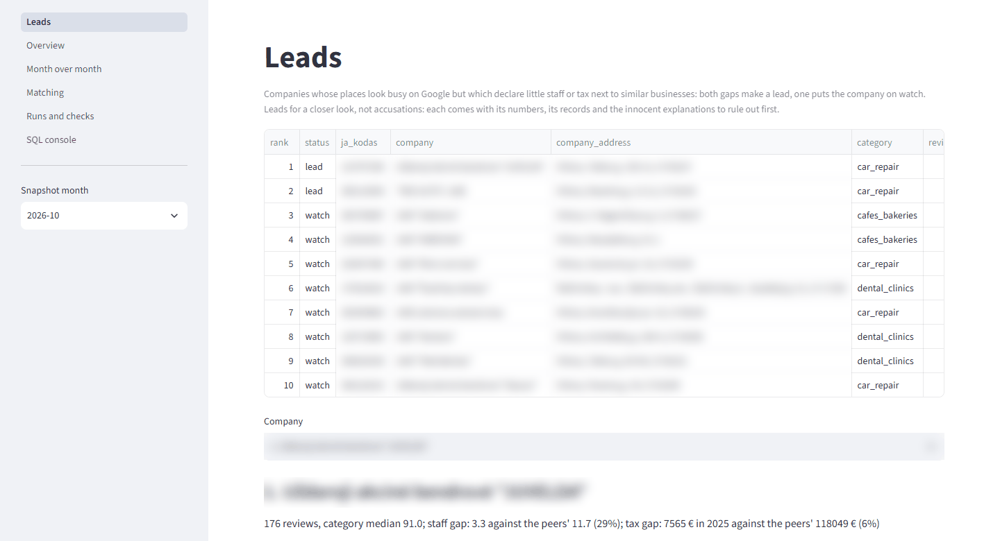
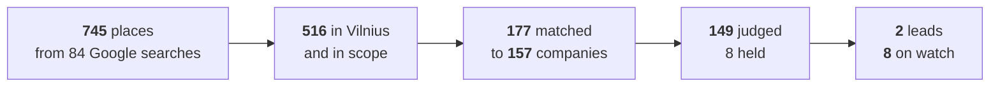
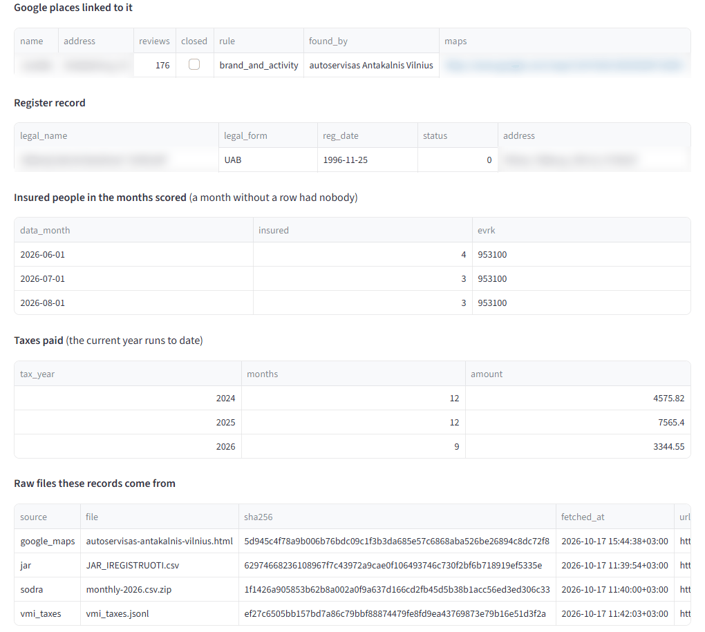
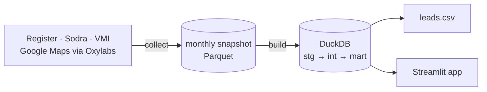
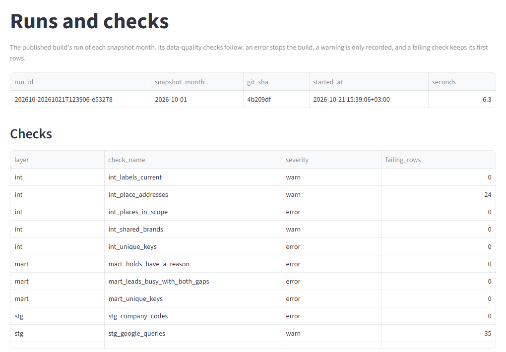
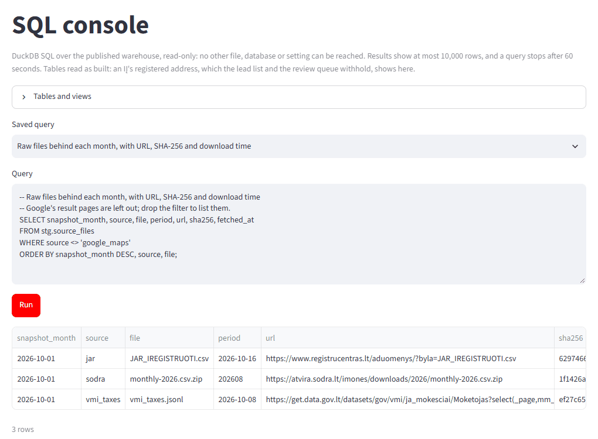

# Leads: busy on Google, quiet on paper

> A garage with a full yard every day and three people on the payroll is worth a closer look.  
> A quiet garage with three people is not.

Every month, this finds Vilnius businesses that look busy on Google Maps but declare little to the
state: few insured staff (Sodra) and little tax (VMI) compared with similar businesses. It's built
for a tax analyst at VMI who has to decide where to look first. Each lead comes with its evidence
and the innocent explanations to rule out first. **Leads for a closer look, not accusations.**



Company names are blurred in these pictures. The real list is [`output/2026-10/leads.csv`](output/2026-10/leads.csv).

## Run it

```bash
docker compose up
```

Then open **http://localhost:8501**. This rebuilds everything from the committed October data and
writes the lead list. No API key needed. Requires Docker Compose 2.24 or later.

## October 2026



| | Judged | Leads | Watch |
|---|---|---|---|
| Cafés and bakeries | 19 | 0 | 2 |
| Car repair | 57 | 2 | 3 |
| Dental clinics | 73 | 0 | 3 |

**Judged** means compared with similar companies. **Held** means there isn't enough data to judge
fairly. A **lead** is busy with both staff and tax far below its peers; **watch** has one of the
two.

## What a lead looks like

Each flagged company gets one line you can read out loud:

> 176 reviews, category median 91.0; staff gap: 3.3 against the peers' 11.7 (29%); tax gap:  
> 7565 € yearly against the peers' 118049 € (6%)

Open it in the app and you see what's behind it: its Google places with Maps links, its register
record, its staff month by month, its tax, and the raw files all of it came from.



## How it works



There are two steps:

- `collect` downloads the month's data and saves it as a snapshot: Parquet files plus a list of
every raw file with its SHA-256. It's the only step that uses the network.
- `build` rebuilds a DuckDB warehouse from all snapshots with plain SQL, running 16
data-quality checks along the way. If a blocking check fails, the new warehouse isn't published.

The same snapshot always gives the same list. A test rebuilds October and compares it byte for
byte.

### The data

| Source | What we take |
|---|---|
| Register of Legal Entities (JAR) | every company: code, name, address, legal form, start date |
| Sodra | insured staff per company per month, and its activity class |
| VMI, through data.gov.lt | tax paid per company per year |
| Google Maps, through the Oxylabs Web API | each place's name, category, address, review count, closed flag |

We look at Vilnius and three kinds of business where customers pay on the spot: cafés and bakeries,
car repair, and dental clinics. A Google results list shows only about 20 places, so we search 4
keywords in each of the city's 21 districts.

The registers are open data. We collect once a month and keep every raw file. From Google we keep only the fields above: no review text, nothing about  
reviewers. Individual enterprises (IĮ) are often named after their owner, so owners' names are  
masked in the snapshot, and an IĮ's address (often a home) never shows in the list.

### Matching places to companies

Google doesn't say which company runs a place, so we match on names and addresses. A company's
**brand** is the quoted part of its legal name: UAB "Kavos namai" is *Kavos namai*. Five rules
are tried in order, and the first one that finds a company wins. The three strong rules link
automatically. The two weaker ones only suggest a company, and a person decides.

| Rule | Match on | Link | October places | Right in sample |
|---|---|---|---|---|
| 1 | same brand, same building | automatic | 69 | 10 of 10 |
| 2 | same brand, matching activity | automatic | 95 | 10 of 10 |
| 3 | same brand without words like "kavinė", same building | automatic | 13 | 10 of 10 |
| 4 | a rare shared word, same street | to review | 22 | 7 of 10 |
| 5 | the only matching company in the building | to review | 45 | 3 of 3 that could be told |

Only automatic links are scored. The samples are small, 10 links per rule. Their verdicts were
proposed from names, addresses and activity codes, and an analyst still needs to confirm them.

### Scoring

- **Busy:** at least 50 reviews and at least the category's median, summed over the company's
places.
- **Staff:** the average insured people over Sodra's latest 3 months, plus one owner for owner-run
forms (MB, IĮ).
- **Tax:** VMI tax for the last full year.
- **Peers:** at least 5 similar companies with one place each, in the same category and of the
same kind (owner-run like MB and IĮ, or not).
- **Lead:** busy, with staff and tax each at most a third of the peers' median. **Watch:** one of
the two, as long as the other isn't above the median.
- **Held:** every place closed, no tax record, started during the tax year, or too few peers. The
reason is shown. A missing tax record never counts as zero.

Every flagged company also lists the innocent explanations: run by its owner, new, several places,
billing through another company (common for dentists), or nobody insured. Both leads stay leads
whether the limit is a third or a half, and whatever the review minimum (25, 50 or 100).

The list goes to `output/<month>/leads.csv`, one row per flagged company. Leads come first, ranked
by how far their tax falls below the peers'.

## The app

Ask follow-up questions without rerunning anything:

- **Leads:** the list, and the evidence behind each company.
- **Overview:** each category from Google places down to judged companies, plus how the leads
change with other limits.
- **Month over month:** what changed since the last month, and why.
- **Matching:** how accurate each rule is, and the places waiting for review.
- **Runs and checks:** every build and its data-quality results.
- **SQL console:** your own read-only SQL, or a saved query.

| Runs and checks | SQL console |
|---|---|
|  |  |

## Limitations

- **Lifetime reviews.** A place that was busy years ago still looks busy.
- **Tax lags behind.** October 2026 compares 2025's tax with today's reviews.
- **Work off the payroll.** Sodra counts insured people only, so contractors and  
extra owners look like missing staff.
- **Revenue in another company.** A business that bills through a related company looks quiet.
- **Addresses we can't read.** 812 companies have an address starting "Vilniaus m. sav." that the
building rules skip.
- **Nameless IĮ.** After masking, two thirds of IĮ (5,561 of 8,270) have no trade name, so they can
only reach the review queue.
- **One month so far.** Month-over-month is built, but it needs more to make observations.

## Roadmap to production

- **Scale: from three business types in Vilnius to all of Lithuania.** The government data is
  ready: the register, Sodra and VMI already list every company in the country. The work is on
  the Google side.
  - *Find every place.* Today each search reads only the first page of results, about 20 places,
    and a third of the searches were full, so some places were missed. Next: scroll for more
    results, and search the map in small squares, splitting a square again while it's still full.
  - *Go faster.* Pages are fetched one at a time. Oxylabs can take many at once.
  - *Add business types easily.* A new type is one entry in the config (its search words and
    Google categories), with no new code.
- **Accuracy: fewer wrong matches, fewer honest businesses flagged.**
  - *Surer matches.* Today a Google place is matched to a company by its name and address. Many
    websites show the company code, which makes the match certain. Comparing map locations
    instead of street names helps too.
  - *Checked matches.* Each rule was checked on only 10 examples, and an analyst still needs to
    confirm them. More checks give numbers we can trust.
  - *Busy now, not years ago.* Reviews pile up over years. Counting only this month's new reviews
    shows who is busy today.
  - *Learn from inspections.* Limits like "a third of the peers" are educated guesses. Once VMI
    inspects some leads, set them from what was actually found.
- **Freshness:** Collect each source when it changes instead of all at once. The register changes
daily; Sodra and VMI update monthly.
- **Monitoring:** Every run and check result is already logged and shown in the app. Next, add
alerts when a build fails or a warning jumps, and track render failures and cost.
- **Cost:** Only Google rendering costs money: 84 pages a month, up to 5 tries each. At scale,
re-render only lists that changed or were full.

## Develop

Requires [uv](https://docs.astral.sh/uv/).

```bash
make test     # tests, no network needed
make lint     # lock file, lint, formatting
make build    # rebuild the warehouse from the snapshots
make app      # run the app on http://localhost:8501
make collect  # download this month (needs OXYLABS_API_KEY in .env, see .env.example)
```

```
src/leads/   pipeline (collect/ per source, app/ for Streamlit)
sql/         stg, int, mart models, dq checks, saved analyst queries
data/        snapshots per month, labelled links
output/      the lead list per month
tests/       pytest
```

CI runs lint, tests and a full build on every push. Why it's built this way, and what was
considered instead: [DECISIONS.md](DECISIONS.md).
